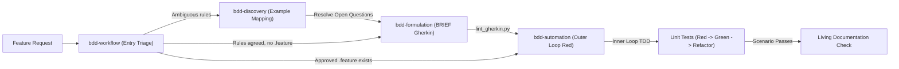

# Full-Stack BDD Coding Skill Suite

An Antigravity plugin and modular skill suite distilling ***BDD in Action (2nd Edition)*** (John Ferguson Smart & Jan Molak) and ***The BDD Books: Discovery & Formulation*** (Gáspár Nagy & Seb Rose) into practical agent workflows, BRIEF Gherkin linting, and multi-stack automation patterns for **TypeScript**, **Python**, and **Rust**.

---

## Workflow Overview



---

## Included Skills

| Skill | Responsibility | References & Scripts |
| :--- | :--- | :--- |
| **`bdd-workflow`** | Orchestrates entry-point triage, Discovery → Formulation → Double-Loop TDD gates, and living-doc verification | [`references/outside-in-loop.md`](./skills/bdd-workflow/references/outside-in-loop.md) |
| **`bdd-discovery`** | Feature Injection, Example Mapping (Rules / Examples / Questions), edge-case checks, and vertical slicing | [`references/example-mapping-patterns.md`](./skills/bdd-discovery/references/example-mapping-patterns.md) |
| **`bdd-formulation`** | BRIEF Gherkin authoring (`Feature`, `Rule`, `Scenario`, `Background`, `Scenario Outline`) and refactoring | [`scripts/lint_gherkin.py`](./skills/bdd-formulation/scripts/lint_gherkin.py), [`references/brief-anti-patterns.md`](./skills/bdd-formulation/references/brief-anti-patterns.md) |
| **`bdd-automation`** | Strict 3-layer separation, Screenplay vs. Domain Driver design, seam allocation, and TS/Python/Rust patterns | [`references/screenplay-and-drivers.md`](./skills/bdd-automation/references/screenplay-and-drivers.md), [`typescript.md`](./skills/bdd-automation/references/typescript.md), [`python.md`](./skills/bdd-automation/references/python.md), [`rust.md`](./skills/bdd-automation/references/rust.md) |

---

## Installing in Antigravity

### Option A: Load via `skills.json` (Workspace or Global)

Add this repository's `skills/` folder to a project's `.agents/skills.json` or your machine-wide `~/.gemini/config/skills.json`:

```json
{
  "entries": [
    { "path": "/home/ccwu/Projects/bdd/skills" }
  ]
}
```

### Option B: Load as an Antigravity Plugin

Symlink or copy `/home/ccwu/Projects/bdd` into a project's `.agents/plugins/bdd` directory or `~/.gemini/config/plugins/bdd` (this repository ships `plugin.json` at its root):

```bash
mkdir -p ~/.gemini/config/plugins
ln -s /home/ccwu/Projects/bdd ~/.gemini/config/plugins/bdd
```

---

## Using the Gherkin Linter (`lint_gherkin.py`)

Validate `.feature` files for Gherkin structural errors and BRIEF specification anti-patterns (dependency-free Python 3.8+):

```bash
# Standard check (exits 1 on structural errors; prints warnings)
python3 skills/bdd-formulation/scripts/lint_gherkin.py path/to/features

# Strict gate (exits 1 on both errors and BRIEF warnings)
python3 skills/bdd-formulation/scripts/lint_gherkin.py --strict path/to/features

# Machine-readable JSON report
python3 skills/bdd-formulation/scripts/lint_gherkin.py --json path/to/features
```
