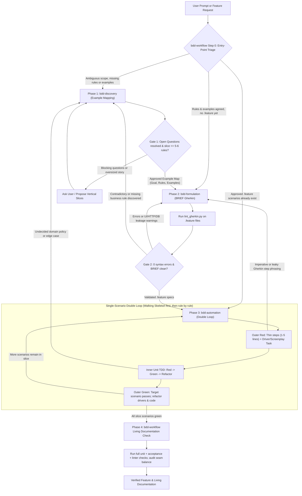
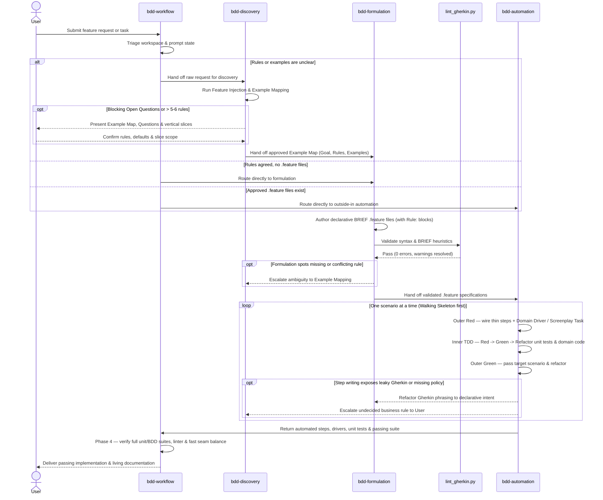

# BDD Skill Handoff Architecture

This document defines how the four modular skills in `/home/ccwu/Projects/bdd` route work, exchange artifacts, enforce quality gates, and escalate backwards when downstream steps uncover upstream gaps.

---

## 1. Handoff & Feedback Flowchart

`bdd-workflow` acts as the entry-point router and lifecycle coordinator. Individual skills can also be invoked standalone when a team enters mid-stream (for example, formulating directly from an existing Example Map or automating pre-approved `.feature` files).

---

## 2. End-to-End Handoff Sequence

---

## 3. Handoff Contracts & Direct Entry Points

### Forward & Feedback Transitions

| Transition | Trigger Condition | Artifact Handed Off | Gate / Acceptance Condition |
| :--- | :--- | :--- | :--- |
| [`bdd-workflow`](./skills/bdd-workflow/SKILL.md) → [`bdd-discovery`](./skills/bdd-discovery/SKILL.md) | Scope is ambiguous, rules are unexamined, or concrete examples/boundaries are missing | Feature goal prompt and codebase context | Entry triage confirms requirements are not yet settled |
| [`bdd-discovery`](./skills/bdd-discovery/SKILL.md) → [`bdd-formulation`](./skills/bdd-formulation/SKILL.md) | Example Map completed for the current vertical slice | Structured Example Map (Goal/Actor/Capability, Rules, Examples + counter-examples) | **Gate 1:** Blocking Open Questions resolved with user (no silent policy invention); slice holds `<= 5–6` rules |
| [`bdd-formulation`](./skills/bdd-formulation/SKILL.md) → [`bdd-automation`](./skills/bdd-automation/SKILL.md) | Gherkin `.feature` files authored and reviewed | Declarative `.feature` specs (`Feature`, `Rule`, `Background`, `Scenario`, `Scenario Outline`) | **Gate 2:** [`lint_gherkin.py`](./skills/bdd-formulation/scripts/lint_gherkin.py) passes with 0 structural errors and BRIEF compliance (zero UI/HTTP/DB leakage) |
| [`bdd-automation`](./skills/bdd-automation/SKILL.md) → [`bdd-workflow`](./skills/bdd-workflow/SKILL.md) | All scenarios in the slice pass outer acceptance and inner unit tests | Thin step glue, Drivers/Screenplay Tasks, test data builders, unit-tested production code | Zero skipped/pending steps; fresh per-scenario state; fast domain/service seam balance verified in [outside-in-loop.md](./skills/bdd-workflow/references/outside-in-loop.md) |
| **Backward:** `bdd-formulation` → `bdd-discovery` | Writing concrete `Given–When–Then` uncovers contradictory or undefined rules | Conflicting rule or uncovered boundary | Resolved via Example Map update and user confirmation |
| **Backward:** `bdd-automation` → `bdd-formulation` | Wiring steps reveals UI selectors, HTTP details, or multi-journey chains in Gherkin | Imperative or bloated scenario | Refactored using [brief-anti-patterns.md](./skills/bdd-formulation/references/brief-anti-patterns.md) and re-linted |
| **Backward:** `bdd-automation` → `bdd-discovery` | Inner TDD exposes an unspecified error path, rounding rule, or concurrency policy | Concrete edge-case question | Clarified with user before inventing domain policy |

### Standalone Direct Invocations

- **Invoke [`bdd-discovery`](./skills/bdd-discovery/SKILL.md) alone** (with [example-mapping-patterns.md](./skills/bdd-discovery/references/example-mapping-patterns.md)) when running requirements discovery or slicing a backlog item before any implementation starts.
- **Invoke [`bdd-formulation`](./skills/bdd-formulation/SKILL.md) alone** (with [`lint_gherkin.py`](./skills/bdd-formulation/scripts/lint_gherkin.py)) when converting an existing Example Map or refactoring brittle legacy `.feature` files.
- **Invoke [`bdd-automation`](./skills/bdd-automation/SKILL.md) alone** (with [screenplay-and-drivers.md](./skills/bdd-automation/references/screenplay-and-drivers.md) and [typescript.md](./skills/bdd-automation/references/typescript.md), [python.md](./skills/bdd-automation/references/python.md), or [rust.md](./skills/bdd-automation/references/rust.md)) when `.feature` specs are already approved and only step wiring, driver architecture, or outside-in TDD implementation is needed.
